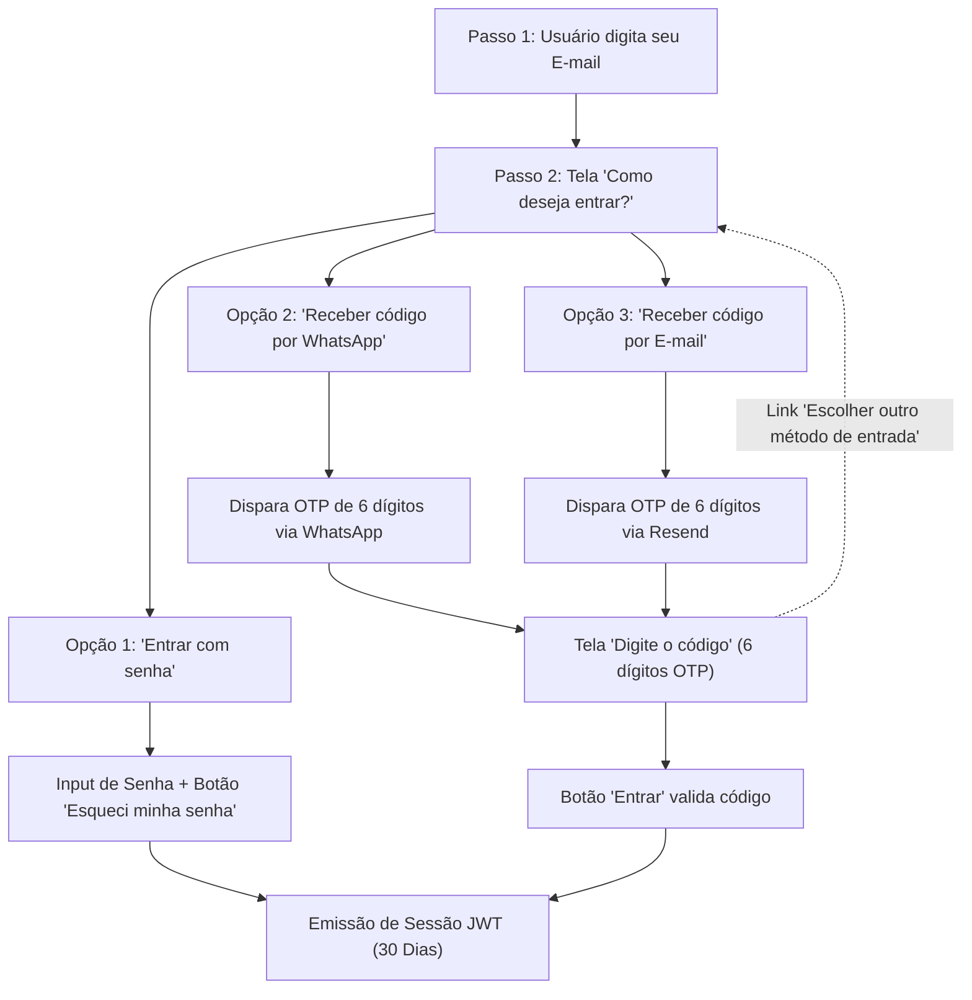
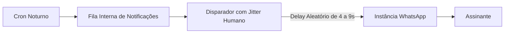
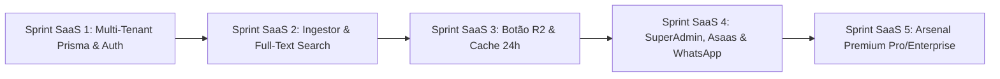

# Plano Mestre de Transição: Portal de Licitações para Plataforma SaaS B2B Multi-Tenant

> **Status:** Documento Oficial de Arquitetura, Produto, Negócio, Segurança e Precificação  
> **Data de Atualização:** 29 de Outubro de 2026  
> **Versão:** 2.0.0 (Pós-Stress Testing & Engenharia de Escala)  
> **Responsáveis:** Vítor Henrique & Squad Antigravity (CEO, Arquiteto, GP, Devs, QA e DevOps)  
> **Repositório:** `portal_licitacao`  
> **Arquivo de Referência:** [`docs/PLANO_TRANSICAO_SAAS_MULTI_TENANT.md`](file:///Users/vitorhenrique/Desktop/Profissional/Programacao/Portal%20de%20Licitacoes/portal_licitacao/docs/PLANO_TRANSICAO_SAAS_MULTI_TENANT.md)  
> **Baseline Ativo na VPS:** Commit `a2e573a` (196/196 testes verdes, 0 erros TypeScript)

---

## 1. Visão Executiva & Propósito da Mudança Estrutural

O **Portal de Licitações**, originalmente projetado como uma ferramenta corporativa interna para uma única empresa operadora de licitações de TI, iniciará seu processo de transição para se tornar uma **Plataforma SaaS B2B Comercial Multi-Tenant**.

### 1.1. Objetivo de Mercado
Comercializar a plataforma no modelo de assinatura mensal/anual para empresas de qualquer porte e segmento que participam ou desejam participar de compras públicas no Brasil, fornecendo inteligência de oportunidades, leitura automática de editais por IA, calendário operacional de prazos, monitoramento de chat do pregoeiro, download ultrarrápido de editais em nuvem e gestão de certidões.

### 1.2. Segmentos-Alvo de Lançamento (Taxonomia de 2 Níveis)
Para eliminar alertas irrelevantes no WhatsApp e no feed, a plataforma opera com uma árvore de 2 níveis (Macro-Segmento ➔ Subcategorias Essenciais):

1. **Saúde, Medicamentos & Hospitalar:**
   - *1.1. Medicamentos & Fármacos* (comprimidos, injetáveis, antibióticos, anestésicos)
   - *1.2. Materiais Hospitalares & Descartáveis* (seringas, luvas, gaze, algodão, cateteres)
   - *1.3. Equipamentos Médicos & Odontológicos* (raio-X, autoclaves, monitores, cadeiras odontológicas)
   - *1.4. Gases Medicinais* (oxigênio hospitalar e cilindros)
2. **Automotivo, Peças & Frotas:**
   - *2.1. Pneus, Câmaras & Recapagem* (linha leve, pesada e agrícola)
   - *2.2. Peças Automotivas & Acessórios* (filtros, pastilhas, suspensão, baterias)
   - *2.3. Óleos Lubrificantes, Fluidos & Graxas*
   - *2.4. Serviços Mecânicos & Manutenção de Frotas*
3. **Obras, Construção Civil & Manutenção:**
   - *3.1. Materiais Básicos de Construção* (cimento, areia, tijolos, tintas, ferragens)
   - *3.2. Obras de Engenharia & Pavimentação* (asfalto, drenagem, reformas prediais)
   - *3.3. Materiais Elétricos & Iluminação Pública* (cabos, postes, lâmpadas LED, disjuntores)
   - *3.4. Materiais Hidráulicos & Saneamento* (tubos, conexões, caixas d'água, bombas)
4. **Alimentos & Merenda Escolar:**
   - *4.1. Gêneros Não-Perecíveis* (arroz, feijão, óleo, açúcar, macarrão, café)
   - *4.2. Hortifrúti Fresco* (frutas, verduras, legumes da agricultura familiar)
   - *4.3. Carnes, Aves, Peixes & Frios* (carnes congeladas, frango, ovos, leite, queijo)
   - *4.4. Panificação & Lanches* (pães, biscoitos, bolos)
5. **Tecnologia da Informação & Telecom:**
   - *5.1. Equipamentos & Hardware* (computadores, notebooks, servidores, nobreaks)
   - *5.2. Softwares, SaaS & Licenças* (sistemas de gestão, licenças Microsoft, portais)
   - *5.3. Redes & Telecomunicações* (fibra óptica, switches, roteadores, internet)
   - *5.4. Serviços Técnicos de Suporte & Manutenção de TI*
6. **Serviços Terceirizados & Operacionais:**
   - *6.1. Limpeza, Conservação & Higienização Predial*
   - *6.2. Vigilância Armada, Desarmada & Segurança Eletrônica*
   - *6.3. Portaria, Recepção & Apoio Administrativo*
   - *6.4. Locação de Máquinas & Veículos Pesados* (caminhões pipa, caçambas, tratores)
7. **Materiais de Escritório, Mobiliário & Suprimentos:**
   - *7.1. Papelaria & Material Escolar/Escritório* (papel A4, pastas, canetas, toners)
   - *7.2. Mobiliário Corporativo & Escolar* (carteiras escolares, mesas, cadeiras giratórias)
   - *7.3. Materiais de Limpeza & Descartáveis* (detergentes, sacos de lixo, papel toalha)
   - *7.4. Uniformes Profissionais, Calçados & EPIs*

### 1.3. Benchmarking de Mercado (Concorrentes Mapeados)
- **Concorrentes de Alto Ticket (Enterprise):** ConLicitação, Effecti, Forseti, SigaPregão (preços entre R$ 200 e R$ 1.200/mês, contratos anuais travados, vendas com reunião de vendedor).
- **Concorrentes de Entrada (Volume):** Licitah (R$ 79,90/mês), Quero Licitação (R$ 49 a R$ 89/mês).
- **Estratégia do Nosso Portal:** Modelo híbrido "Freemium / Low-Ticket to High-Value". Entrada ultra acessível no Básico (R$ 59,90) para captar clientes do Licitah sem atrito, e escada de valor agressiva nos planos superiores (R$ 97 e R$ 197) entregando recursos de ponta que os concorrentes cobram mais de R$ 400.

---

## 2. Varredura do Sistema Atual (Baseline Pré-Transição)

Antes de iniciar as alterações estruturais, foi realizada uma varredura rigorosa em todas as camadas do sistema para atestar a ausência de débitos técnicos:

| Camada | Validação | Status | Resultado |
| :--- | :--- | :---: | :--- |
| **Tipagem Estática** | `tsc --noEmit` (`strict: true`) | APROVADO | **0 erros de tipo.** |
| **Testes Automatizados** | Vitest (`vitest run`) | APROVADO | **196 de 196 testes verdes** (26 arquivos de teste). |
| **Build de Produção** | Next.js 15 App Router | APROVADO | **28 rotas** estáticas e dinâmicas compiladas com sucesso. |
| **Controle de Versão** | Git `main` | APROVADO | Working tree limpa, commit `a2e573a` ativo na VPS. |

---

## 3. Arquitetura de Dados Multi-Tenant & Modelagem Prisma

```mermaid
graph TD
    subgraph "Catálogo Global Público (Somente Leitura para Clientes)"
        PNCP["API Federal PNCP"] --> Ingestor["Worker Noturno (01:00 às 02:00)"]
        Ingestor --> LicitacaoGlobal[("Licitacao (Global Compartilhada)")]
    end

    subgraph "Camada Multi-Tenant Isolada"
        TenantA["Tenant: Farmácia Alpha (CNPJ A)"]
        TenantB["Tenant: Construtora Beta (CNPJ B)"]
        
        TenantA --> CarteiraA[("TenantLicitacao (Kanban Privado A)")]
        TenantA --> DocsA[("Documentos Privados A")]
        
        TenantB --> CarteiraB[("TenantLicitacao (Kanban Privado B)")]
        TenantB --> DocsB[("Documentos Privados B")]
        
        UserConsultor["Usuário / Consultor de Licitações"]
        UserConsultor -.->|TenantUser (Associação A)| TenantA
        UserConsultor -.->|TenantUser (Associação B)| TenantB
    end

    LicitacaoGlobal -.->|Adicionar à Carteira| CarteiraA
    LicitacaoGlobal -.->|Adicionar à Carteira| CarteiraB
```

### 3.1. Desacoplamento do Status da Licitação (Fim do Risco de Sobrescrita)
No modelo original de single-tenant, o campo `status` pertencia à tabela `Licitacao`. Na arquitetura SaaS, o catálogo global é imutável pelos clientes. O progresso de cada certame é controlado na tabela `TenantLicitacao`:

```prisma
model TenantLicitacao {
  id              String          @id @default(cuid())
  tenantId        String
  licitacaoId     String
  status          LicitacaoStatus @default(PENDENTE) // Kanban privado do cliente
  anotacoes       String?         @db.Text
  favorito        Boolean         @default(false)
  valorProposta   Float?
  dataAtualizacao DateTime        @updatedAt

  tenant    Tenant    @relation(fields: [tenantId], references: [id], onDelete: Cascade)
  licitacao Licitacao @relation(fields: [licitacaoId], references: [id], onDelete: Cascade)

  @@unique([tenantId, licitacaoId])
  @@index([tenantId, status])
}
```

### 3.2. Suporte a Consultores e Operadores com Múltiplos CNPJs
Para atender consultores que operam pregões para múltiplas empresas simultaneamente, a relação entre `User` e `Tenant` é desacoplada através da entidade `TenantUser`:

```prisma
model TenantUser {
  id        String   @id @default(cuid())
  tenantId  String
  userId    String
  papel     String   @default("MEMBRO") // TITULAR | MEMBRO
  criadoEm  DateTime @default(now())

  tenant Tenant @relation(fields: [tenantId], references: [id], onDelete: Cascade)
  user   User   @relation(fields: [userId], references: [id], onDelete: Cascade)

  @@unique([tenantId, userId])
  @@index([userId])
}
```
* **UX de Troca de Contexto:** O cookie de sessão guarda o `activeTenantId`. Na barra superior do portal, um dropdown **"Alternar Empresa / CNPJ"** permite transitar entre clientes em 1 clique sem deslogar.

### 3.3. Blindagem contra Vazamento de Dados (Prisma Client Extension)
Para eliminar o risco de esquecimento de `where: { tenantId }`, a camada de serviços utilizará uma extensão do Prisma (`getTenantPrisma(tenantId)`):
* Todas as queries para `Documento`, `TenantLicitacao`, `ConfiguracaoEmpresa` e `AuditLog` têm a cláusula `tenantId` automaticamente injetada pelo cliente Prisma.
* Qualquer tentativa de acessar registros privados de outro `tenantId` lança exceção em tempo de execução.

### 3.4. Regras de Unicidade, Validação e Limite de CNPJs por Conta (Superpowers Rigor)
Para garantir a máxima integridade jurídica, financeira e de dados entre concorrentes no mercado público:

1. **Unicidade Global de E-mail (`User.email`):**
   - **Chave de Identidade Única:** O e-mail é a chave primária de identificação do usuário (`@unique` no banco de dados).
   - **Sanitização Obrigatória em Runtime:** Todos os e-mails passam por `email.trim().toLowerCase()` antes de qualquer operação de persistência ou busca.
   - **Validação de Formato Rigorosa (RFC 5322):** Validado com schema Zod `z.string().email().max(150)`.
   - **Bloqueio de E-mails Descartáveis / Temporários:** Blacklist ativa em runtime bloqueando domínios de e-mails descartáveis conhecidos (ex.: `@mailinator.com`, `@guerrillamail.com`, `@10minutemail.com`, `@tempmail.com`), impedindo fraudes no período de Trial gratuito.
   - **Modelo 1 Usuário : N Tenants:** Um único e-mail/usuário pode ter acesso a múltiplos CNPJs (via tabela associativa `TenantUser`), eliminando a necessidade de criar múltiplos cadastros para o mesmo operador.

2. **Unicidade Global de CNPJ (`Tenant.cnpj` - Proibição Absoluta de Duplicidade):**
   - **Chave Empresarial Única:** O campo `Tenant.cnpj` é indexado como `@unique` no PostgreSQL.
   - **Proibição de Duplo Registro:** Duas contas/assinaturas distintas **NUNCA podem cadastrar o mesmo CNPJ**.
   - **Tratamento de Concorrência & Colisão:**
     - A API intercepta violações de unicidade (`PrismaClientKnownRequestError` com código `P2002`).
     - Em caso de colisão, a API retorna `HTTP 409 Conflict` com código `CNPJ_ALREADY_REGISTERED`.
     - O frontend IBM Carbon exibe imediatamente uma notificação amigável e segura:
       > *"⚠️ Este CNPJ já possui uma conta ativa no Portal. Caso você faça parte da equipe desta empresa, solicite ao titular da conta o envio de um convite de acesso para o seu e-mail corporativo."*

3. **Mecanismo de Contestação e Reivindicação de Titularidade de CNPJ (Dispute Flow):**
   Para evitar que terceiros não autorizados registrem indevidamente o CNPJ de uma empresa legítima:
   - **Fluxo 1 — Validação Automática via E-mail da Receita Federal:**  
     O usuário pode clicar em *"Reivindicar Titularidade deste CNPJ"*. O sistema consulta a base pública da Receita Federal (via BrasilAPI / ReceitaWS) e dispara um código OTP de 6 dígitos para o e-mail oficial constante no Cartão CNPJ cadastrado na Receita. Ao digitar o código correto, a titularidade é transferida para o novo requerente e o cadastro indevido anterior tem seus acessos revogados.
   - **Fluxo 2 — Validação Documental com Suporte Humano:**  
     Caso a empresa não tenha mais acesso ao e-mail registrado na Receita Federal, o sistema permite o upload do Contrato Social / Certidão Simplificada da Junta Comercial e documento de identificação do sócio administrador. O SuperAdmin audita e libera em até 24h úteis.

4. **Validação Algorítmica dos Dígitos Verificadores do CNPJ (Módulo 11):**
   - Validação matemática estrita dos 14 dígitos utilizando o algoritmo oficial de dois dígitos verificadores em Módulo 11 da Receita Federal:
     - Dígito 1: pesos `[5, 4, 3, 2, 9, 8, 7, 6, 5, 4, 3, 2]`.
     - Dígito 2: pesos `[6, 5, 4, 3, 2, 9, 8, 7, 6, 5, 4, 3, 2]`.
   - **Rejeição Imediata de Sequências Falsas:** Bloqueio de CNPJs formados por 14 dígitos idênticos (`00.000.000/0000-00`, `11.111.111/1111-11`, ..., `99.999.999/9999-99`).
   - **Enriquecimento Automático Cadastral:** Após validação dos dígitos, o sistema autocompleta Razão Social, Nome Fantasia, CNAE Principal e Endereço através da BrasilAPI (com fallback transparente para ReceitaWS).

5. **Limite de CNPJs Ativos por Plano de Assinatura (Enforcement em Runtime):**
   - **Plano Básico:** 1 CNPJ ativo.
   - **Plano Pro:** Até 2 CNPJs ativos (ex.: Matriz e Filial, ou duas empresas do mesmo grupo/sócio).
   - **Plano Enterprise:** Até 5 CNPJs ativos (para grupos econômicos, holdings e consultorias com carteira de clientes).
   - **Validação de Cota:** Antes de cadastrar um novo CNPJ (`POST /api/tenants`), o backend verifica `count(user.tenantsOwned) < plan.maxTenants`. Caso atinja o teto, retorna `HTTP 403 Forbidden` com código `PLAN_CNPJ_LIMIT_REACHED` e abre o Modal Carbon convidando para upgrade de plano.

6. **Validação de Convites de Membros da Equipe:**
   - Proteção de integridade `@@unique([tenantId, userId])` impedindo duplicidade de vínculo entre usuário e empresa.
   - O titular não pode convidar seu próprio e-mail (`userId === inviteeId`).
   - Não é permitido reenviar convite para um e-mail que já seja membro ativo do mesmo CNPJ.
   - Convites geram tokens criptográficos seguros (UUIDv4) com expiração em 7 dias. Se o usuário já tiver conta no portal, o vínculo ao novo CNPJ é instantâneo; se não tiver, o link direciona para criação de senha pessoal.

---

## 4. Autenticação, Fluxo de Login Multicanal, Sessão de 30 Dias & Segurança

### 4.1. Fluxo de Login Multicanal em 2 Etapas (Referência Visual Aprovada)
Para proporcionar a experiência mais moderna e sem atritos do mercado B2B, a tela de autenticação do portal (`/login`) operará com 3 modalidades de entrada selecionáveis pelo usuário após a identificação do e-mail:



1. **Passo 1 (Identificação):** O usuário digita seu e-mail corporativo. O sistema valida o cadastro.
2. **Passo 2 (Menu de Escolha "Como deseja entrar?"):**
   - **Opção A — "Entrar com senha":** Exibe o campo de senha tradicional com criptografia forte (bcryptjs) e link *"Esqueci minha senha"*.
   - **Opção B — "Receber código por WhatsApp":** Gera um código OTP de 6 dígitos e envia instantaneamente via WhatsApp (Evolution API / Z-API). Exibe toast de notificação no canto superior direito: *"Código enviado para o seu WhatsApp cadastrado!"*.
   - **Opção C — "Receber código por E-mail":** Gera o código OTP de 6 dígitos e envia via e-mail transacional (Resend).
3. **Passo 3 (Tela "Digite o código"):**
   - Campo para inserção dos 6 dígitos numéricos com feedback visual imediato.
   - Botão de ação principal: **"Entrar"**.
   - Link inferior de retorno: **"Escolher outro método de entrada"** (permitindo alternar para senha ou e-mail caso o usuário queira mudar o canal).

### 4.2. Duração do Token e Política de Sessão (30 Dias de Persistência)
* **Duração da Sessão:** O token de autenticação JWT tem validade de **30 dias (`maxAge: 30 * 24 * 60 * 60` segundos = 2.592.000s)**.
* **Por que 30 dias?** É o padrão ouro de usabilidade em ferramentas de trabalho B2B diárias (como Slack, Notion, Asaas e Linear). Elimina a fricção diária de redigitar senhas ou solicitar códigos a cada vez que o operador de licitações abrir o navegador.
* **Rolling Session (Renovação Suave):** A cada uso ativo do portal, a expiração de 30 dias é estendida automaticamente em segundo plano.
* **Armazenamento Seguro:** O JWT reside exclusivamente em **Cookie HttpOnly com flags `SameSite=Lax` e `Secure`**, inacessível a scripts no navegador (imunidade nativa a ataques XSS).
* **Payload da Sessão:**
  ```json
  {
    "userId": "usr_123",
    "email": "gestor@empresa.com.br",
    "nome": "Carlos Silva",
    "activeTenantId": "tnt_abc",
    "cnpj": "12.345.678/0001-90",
    "plano": "PRO",
    "status": "ACTIVE",
    "exp": 1732900000
  }
  ```
* **Invalidação Imediata (Killswitch de Segurança):** Se a senha do usuário for alterada ou se o titular do CNPJ revogar o acesso de um membro da equipe, a sessão é invalidada imediatamente no servidor antes do prazo de 30 dias.

### 4.3. Proteção Anti-Brute Force (Rate Limiting) & Anti-Bot
1. **Tentativas de Senha Incorreta:** Máximo de 5 tentativas falhas em 15 minutos por IP/e-mail. Ao atingir a 5ª falha: congelamento temporário da conta por 15 minutos e envio de alerta de segurança no e-mail do titular.
2. **Proteção nos Endpoints de OTP (WhatsApp e E-mail):** Máximo de 3 solicitações a cada 10 minutos por número/IP, impedindo bombardeamento de mensagens e custos desnecessários nas APIs.
3. **Cloudflare Turnstile (CAPTCHA Invisível):** Validação silenciosa sem desafios de imagens em `/cadastro`, `/login` e `/recuperar-senha`.
4. **Botão Flutuante de Suporte Humanizado:** No canto inferior direito, acionando WhatsApp oficial de suporte com dados do assinante pré-preenchidos.

---

## 5. Onboarding Guiado, Momento Aha! nos Primeiros 5 Minutos & Conversão do Trial (14 Dias)

### 5.1. O Desafio do Trial Sem Cartão
Em modelos sem cartão de crédito, 65% dos usuários abandonam a plataforma se encontrarem uma tela em branco ou complexa. O onboarding deve entregar valor nos primeiros 90 segundos:

```
[ Minuto 0: Cadastro ] ──► Digita CNPJ (Receita preenche Razão Social e Cidade)
           │
[ Minuto 1: Filtros ]  ──► Marca seus nichos principais (ex: Farmácia e Pneus)
           │
[ Minuto 2: Momento Aha! ] Contador Animado: "Encontramos 18 licitações abertas (R$ 4.2M)"
           │
[ Minuto 3: Impacto Real ] Celular vibra: WhatsApp de Boas-Vindas com 3 editais reais do nicho dele
           │
[ Minuto 5: Degustação ] Botão: "Gerar 1 Análise de Edital com IA Grátis Agora"
```

1. **Wizard de Entrada em 3 Passos:**
   - **Passo 1:** Digita o CNPJ. Consulta instantânea da Receita Federal autopreenchendo Razão Social, Endereço e CNAE.
   - **Passo 2:** Sugestão automática do segmento a partir do CNAE com confirmação em 1 clique.
   - **Passo 3:** Inserção do WhatsApp para recebimento de alertas.
2. **Ativação Imediata no Feed:** Painel de impacto mostrando o total de certames abertos e o valor monetário estimado disponível no estado do cliente.
3. **Validação Instantânea no Celular:** Disparo em 30 segundos da mensagem de boas-vindas com 3 links de editais quentes do nicho cadastrado.
4. **Degustação da IA no Dia 1:** O assinante do trial recebe 1 análise completa de IA gratuita para testar o Dossiê Executivo de Viabilidade.

---

## 6. Billing Asaas, Idempotência de Webhooks & Paywall Suave

### 6.1. Idempotência Atômica de Webhooks
Para evitar cobranças duplicadas, concessões indevidas de cotas ou disparos repetidos de e-mails via Resend por reenvios de webhook do Asaas:

```prisma
model AsaasWebhookEvent {
  id            String   @id // ID do evento do Asaas (ex: "evt_0019283")
  evento        String   // PAYMENT_RECEIVED, PAYMENT_OVERDUE, etc.
  tenantId      String?
  processado    Boolean  @default(false)
  processadoEm  DateTime?
  criadoEm      DateTime @default(now())

  @@index([id])
}
```
* **Processamento:** O endpoint `/api/webhooks/asaas` executa `INSERT INTO "AsaasWebhookEvent" ON CONFLICT DO NOTHING`. Se o evento já existir, retorna `HTTP 200 OK` de imediato. As mutações de status financeiro ocorrem dentro de `$transaction`.

### 6.2. Paywall Suave & Período de Graça (Grace Period de 3 Dias)
1. **Período de Graça (3 Dias):** Se o pagamento vencer no dia 10, o cliente entra em `GRACE_PERIOD` (banner amarelo com link de regularização, mas acesso liberado). O bloqueio suave ocorre apenas no 4º dia pós-vencimento, evitando atritos com prazos de compensação de boletos e PIX.
2. **Whitelist Estrita no Middleware Next.js:** O middleware intercepta clientes com status `TRIAL_EXPIRED` ou `OVERDUE` e redireciona para a home com banner fixo de regularização, liberando estritamente:
   `/`, `/login`, `/recuperar-senha`, `/checkout`, `/api/auth/*`, `/api/webhooks/*`, `/api/suporte`, `/_next/*`.

---

## 7. Estratégia Anti-Ban e Governança de WhatsApp

Para blindar o chip da empresa contra banimentos automatizados da Meta:



1. **Fila com Jitter Humano:** Disparos matinais nunca saem em bloco simultâneo. Cada mensagem respeita um intervalo aleatório de **4 a 9 segundos**.
2. **Janela Escalonada:** Disparos distribuídos entre **06:30 e 08:30 da manhã**, agrupados por fuso e região.
3. **Mecanismo Anti-Spam com Opt-Out:** Toda mensagem contém: *"Para pausar estes alertas, responda PAUSAR a qualquer momento"*. Se o cliente responder, o envio é pausado no banco, eliminando o risco de denúncias de spam na Meta.
4. **Aquecimento Gradual (Warm-up):** Limite de 30 mensagens/dia na primeira semana do chip, subindo progressivamente.

---

## 8. Engenharia de Performance no PostgreSQL & Limites da VPS Hostinger (100 GB)

### 8.1. Full-Text Search Nativo (< 15ms)
Para pesquisar centenas de milhares de licitações sem a sobrecarga de memória de ferramentas externas:
1. **Coluna `tsvector` com Dicionário em Português:**
   ```sql
   ALTER TABLE "Licitacao" ADD COLUMN "buscaVetor" tsvector 
   GENERATED ALWAYS AS (
     to_tsvector('portuguese', coalesce("objeto", '') || ' ' || coalesce("orgaoNome", '') || ' ' || coalesce("municipio", ''))
   ) STORED;
   ```
2. **Índice Invertido GIN:**
   ```sql
   CREATE INDEX "idx_licitacao_busca_vetor" ON "Licitacao" USING GIN ("buscaVetor");
   ```
3. **Índice de Trigrama para Códigos e Erros Ortográficos:**
   ```sql
   CREATE EXTENSION IF NOT EXISTS pg_trgm;
   CREATE INDEX "idx_licitacao_objeto_trgm" ON "Licitacao" USING GIN ("objeto" gin_trgm_ops);
   ```

### 8.2. Manutenção do Disco da VPS (KVM 2 100 GB)
- **Calibragem do Autovacuum:** `autovacuum_vacuum_scale_factor = 0.05` para evitar bloat de tabelas com grande rotação diária.
- **Purga Semanal de Dados Temporários:** Limpeza de logs de auditoria superiores a 60 dias e tokens expirados, garantindo estabilidade do banco abaixo de 20 GB.

---

## 9. Engenharia de Ingestão Noturna (01:00 às 02:00) & Modalidades da Lei 14.133

### 9.1. Catálogo de Modalidades Oficiais no PNCP

| Código PNCP | Modalidade | Participação de Mercado | Relevância Comercial |
| :---: | :--- | :---: | :--- |
| **6** | **Pregão Eletrônico** | **~60% do volume financeiro** | Carro-chefe de bens e serviços comuns com disputa de lances. |
| **8** | **Dispensa de Licitação (Compra Direta)** | **~40% dos editais diários** | Contratações ágeis (até R$ 59,9k compras / R$ 119,8k obras). Essencial para PMEs. |
| **5** | **Concorrência Eletrônica** | **Alto valor / Obras** | Grandes contratos, concessões e projetos de engenharia complexos. |
| **9** | **Inexigibilidade de Licitação** | **Especialidades** | Credenciamentos públicos e contratação de fornecedores exclusivos. |
| **1** | **Leilão Eletrônico** | **Alienações** | Alienação de veículos, sucatas e bens desincorporados da administração. |

### 9.2. Taxonomia e Ingestão Noturna
- Worker Cron nativo (Node.js/TypeScript) executa diariamente entre 01:00 e 02:00.
- Consulta as contratações publicadas nas últimas 24 horas na API pública do PNCP.
- Cruza `objetoCompra`, descrição e códigos CATMAT/CATSER com o dicionário semântico oficial, indexando tags de segmento (Farmácia, Pneus, Construção, Alimentos, TI...).
- Executa UPSERT idempotente com base no `numeroControlePNCP`.

---

## 10. Arquitetura de Armazenamento Zero-PDF na Hostinger & Lazy Caching no Cloudflare R2

### 10.1. Princípio Zero-PDF no Servidor Local
- O disco NVMe de 100 GB da Hostinger permanece restrito ao Sistema Operacional Ubuntu, containers Docker e dados textuais do PostgreSQL.
- **Nenhum arquivo PDF de edital é salvo no disco da VPS.**

### 10.2. Armazenamento Externo Cloudflare R2
- Todos os documentos residem no Cloudflare R2 (custo de tráfego/egress = **$0,00**, armazenamento = **$0,015/GB/mês**).

### 10.3. Botão "Abrir Documentos" com Revalidação Diária (TTL 24h)
1. **Primeiro Acesso:** Ao clicar em "Abrir Documentos", modal exibe loading de sincronização. O backend consome os arquivos no PNCP, faz o streaming direto para o R2, salva os links no banco e atualiza `lastCheckedAt = hoje`.
2. **Acesso no Mesmo Dia:** Exibição instantânea (< 100ms) consumindo os links do R2 sem nova chamada ao PNCP.
3. **Acesso em Dias Posteriores (> 24h):** O backend realiza checagem rápida no PNCP. Se o órgão publicou retificações, termos aditivos ou respostas a esclarecimentos, faz o download apenas dos novos arquivos e atualiza a lista.
4. **Resiliência a Falhas do Governo:** Se o portal federal sair do ar (erros 502/504), os documentos já cacheados no R2 continuam acessíveis aos nossos clientes sem interrupção.

---

## 11. Monitoramento e Sincronização de Prorrogações de Prazos

1. **Rastreio Automático:** Durante a rotina da madrugada ou a abertura de documentos, o sistema compara a `dataEncerramentoProposta` retornada pelo PNCP com a gravada no banco.
2. **Atualização Operacional:**
   - Atualiza `dataFimEnvioProposta` na tabela global.
   - O card da licitação na tela de [Calendário](file:///src/app/calendario/page.tsx) move-se automaticamente para o novo dia e horário.
   - **Alerta Imediato no WhatsApp:** Disparo de notificação para todos os clientes que adicionaram a oportunidade ao Kanban informando a prorrogação com as datas anterior e nova.

---

## 12. Arsenal Pro & Enterprise (Módulos de Alto Valor)

1. **Monitor de Chat do Pregoeiro no WhatsApp:** Monitoramento contínuo das salas de disputa dos certames aceitos; ao citar o CNPJ ou Razão Social da empresa, dispara alerta sonoro e WhatsApp imediato para envio de proposta readequada em prazo fatal.
2. **Gerador de Minutas de Impugnação com IA (Art. 164 Lei 14.133):** Redação jurídica fundamentada na Nova Lei de Licitações e acórdãos do TCU com 1 clique para certames com exigências ilegais ou direcionamento.
3. **Inteligência de Preços dos Concorrentes:** Painel histórico de homologações para o mesmo item/CATMAT nos últimos 12 meses, revelando empresas vencedoras e desconto médio praticado.
4. **Calculadora de Lance Mínimo & Simulador de BDI:** Definição do preço mínimo seguro e alertas visuais contra lances com margem negativa na disputa.
5. **Gerador Automático de Propostas Comerciais em PDF Timbrado:** Diagramação oficial com tabela de itens, dados bancários e validade em layout corporativo da empresa assinante.
6. **Relatórios Executivos Mensais de Desempenho:** Relatório consolidado em PDF de 1 página para diretoria no final do mês com taxa de conversão e volume financeiro disputado.

---

## 13. Portal Administrativo (SuperAdmin / Backoffice)

Painel restrito à gestão da plataforma (`admin.portal.com.br`):
1. **Conector WhatsApp:** Pareamento por QR Code (Evolution API / Z-API), status de conexão e fila de mensagens.
2. **Gestão de Assinaturas & Clientes:** Visão de clientes por CNPJ, dias restantes de trial e prorrogação manual de testes.
3. **Métricas Financeiras Asaas:** MRR, inadimplência e status de webhooks.
4. **Health Check da Ingestão:** Relatório da coleta da madrugada e integridade do cache R2.

---

## 14. Modelo Oficial de Preços e Escada de Valor

```
                      ESCADA DE VALOR DO PORTAL
                      
   [ Plano Enterprise: R$ 197/mês ] ──► Até 5 Usuários, Chat Pregoeiro, IA Impugnação, BI Preços
             ▲
   [ Plano Pro: R$ 97/mês ] ──────────► Até 2 Usuários, Parecer IA 20 editais, Proposta PDF, WhatsApp
             ▲
   [ Plano Básico: R$ 59,90/mês ] ────► 1 Usuário, Busca ilimitada, Calendário, 1 Segmento
```

| Recurso / Ferramenta | **Plano Básico** | **Plano Pro (Mais Popular)** | **Plano Enterprise / Escala** |
| :--- | :---: | :---: | :---: |
| **Mensalidade (Sem fidelidade)** | **R$ 59,90 / mês** | **R$ 97,00 / mês** | **R$ 197,00 / mês** |
| **Plano Anual (com desconto)** | **R$ 49,90 / mês** | **R$ 79,90 / mês** | **R$ 159,90 / mês** |
| **Período de Testes (Trial)** | **14 Dias Grátis (Sem Cartão)** | **14 Dias Grátis (Sem Cartão)** | **14 Dias Grátis (Sem Cartão)** |
| **CNPJs Cadastrados por Conta** | **1 CNPJ** | **Até 2 CNPJs** | **Até 5 CNPJs** |
| **Usuários com Acesso Total** | **1 Usuário (Titular)** | **Até 2 Usuários** | **Até 5 Usuários** |
| **Gestão de Convites da Equipe** | Não incluso | Incluso (1 convite) | Incluso (até 4 convites) |
| **Macro-Segmentos Monitorados** | **1 Macro-Segmento** *(todas as subsessões liberadas)* | **Até 3 Macro-Segmentos** *(todas as subsessões liberadas)* | **Todos os 7 Segmentos (Ilimitado)** |
| **Subcategorias / Sub-sessões** | **Todas do Segmento Liberadas** | **Todas dos 3 Segmentos Liberadas** | **Todas Liberadas (Acesso Total)** |
| **Modalidades de Licitação** | Todas (Pregão, Dispensa...) | Todas (Pregão, Dispensa...) | Todas (Pregão, Dispensa...) |
| **Abrangência Geográfica** | 1 Estado (UF sede) | Brasil Todo (26 UFs + DF) | Brasil Todo (26 UFs + DF) |
| **Alertas no WhatsApp** | 1 Resumo diário matinal | Instantâneo ao publicar | Instantâneo + Múltiplos Números |
| **Alerta de Mudança de Data** | Incluso | Incluso | Incluso prioritário |
| **Download de Editais (R2)** | Incluso via botão | Incluso via botão | Incluso de alta velocidade |
| **Análise de IA & Dossiê** | Não incluso | **Até 20 editais por mês** | **Até 60 editais por mês** |
| **Calendário de Prazos Fatais** | Incluso | Incluso | Incluso |
| **Gestor de Validade de Certidões** | Não incluso | Incluso (alertas automáticos) | Incluso completo |
| **Calculadora de Lance Mínimo** | Incluso | Incluso | Incluso |
| **Gerador de Propostas em PDF** | Não incluso | Incluso | Incluso |
| **Monitor de Chat do Pregoeiro** | Não incluso | Não incluso | **Incluso com Alerta WhatsApp** |
| **Minutas de Impugnação com IA** | Não incluso | Não incluso | **Incluso (Art. 164 Lei 14.133)** |
| **Inteligência de Preços Concorrentes**| Não incluso | Não incluso | **Incluso (Histórico Homologado)** |
| **Relatórios Executivos Mensais** | Não incluso | Não incluso | **Incluso (PDF para Diretoria)** |
| **Robô de Lances** | Não incluso | Add-on futuro | Prioridade máxima de acesso |

---

## 15. Esteira Oficial de Sprints da Squad

Para garantir entregas previsíveis, sem regressões e com validação contínua na VPS Hostinger, a execução do plano seguirá a esteira oficial de Sprints da Squad Antigravity:



1. **Sprint SaaS 1: Modelagem Multi-Tenant Prisma, Schemas, Sessão JWT, TenantUser e Convites**
   - Criação da entidade `Tenant` vinculada ao CNPJ, modelo `TenantUser` para suporte a consultores com múltiplos CNPJs, modelo `TenantLicitacao` (desacoplamento do status do Kanban) e extensão Prisma `$extends` para isolamento de dados.
2. **Sprint SaaS 2: Motor de Ingestão Noturna (01:00 às 02:00), Dicionário de Segmentos & Full-Text Search**
   - Cron nativo conectando à API pública do PNCP, suporte integral às modalidades (Pregão, Dispensa, Concorrência...), índice GIN com `tsvector` nativo em português e rastreamento de prorrogações de datas.
3. **Sprint SaaS 3: Botão "Abrir Documentos", Streaming Cloudflare R2 & Cache Diário (TTL 24h)**
   - Interface com modal de carregamento sincronizado ao PNCP, upload em streaming para o Cloudflare R2, revalidação diária e proteção contra indisponibilidade do PNCP.
4. **Sprint SaaS 4: Portal SuperAdmin, Conexão WhatsApp com Jitter, Billing Asaas & Paywall Suave**
   - Painel para pareamento de QR Code WhatsApp, fila anti-ban com delay humano (4 a 9s), webhooks idempotentes do Asaas, régua transacional Resend e middleware de redirecionamento suave com Grace Period.
5. **Sprint SaaS 5: Ferramentas Premium de Expansão (Pro & Enterprise)**
   - Gerador de Propostas Comerciais em PDF Timbrado, Calculadora de Margem/BDI, Gerador de Minutas de Impugnação com IA e Monitor de Chat do Pregoeiro com alertas sonoros e WhatsApp.

---

## 16. Matriz de Decisões Técnicas e de Negócio Consolidadas

> [!NOTE]
> Checklist de encerramento do planejamento pré-desenvolvimento:

- [x] **Modelo de Contas & Unicidade:** Cadastro atrelado ao e-mail (`User.email` `@unique`, sanitizado com bloqueio de temporários). CNPJ exclusivo (`Tenant.cnpj` `@unique`) — duas contas não podem cadastrar o mesmo CNPJ.
- [x] **Regra de CNPJs por Plano:** Limite de 1 CNPJ no Básico, até 2 CNPJs no Pro e até 5 CNPJs no Enterprise, com validação de cota em tempo de execução.
- [x] **Proteção & Reivindicação de CNPJ:** Algoritmo oficial de módulo 11, bloqueio de e-mails descartáveis e fluxo de contestação de titularidade via e-mail oficial da Receita Federal ou suporte.
- [x] **Segmentos vs Sub-segmentos:** Limite por Macro-Segmentos (1 no Básico, 3 no Pro, Ilimitado no Enterprise), com livre acesso e filtros granulares em todas as subsessões e CATMATs pertencentes ao segmento contratado.
- [x] **Isolamento de Dados:** Desacoplamento do Kanban em `TenantLicitacao` e blindagem via Prisma `$extends`.
- [x] **Autenticação Multicanal:** 3 modalidades de entrada (Senha tradicional, Código OTP via WhatsApp e Código OTP via E-mail) com tela de seleção e fallback 'Escolher outro método de entrada'.
- [x] **Duração da Sessão:** Token JWT persistente por 30 dias em Cookie HttpOnly com renovação suave (rolling session).
- [x] **Segurança de Borda:** Rate Limiting (5 tentativas de login em 15 min; 3 OTPs em 10 min) + Cloudflare Turnstile invisível.
- [x] **Suporte ao Usuário:** Botão flutuante Carbon com acionamento de WhatsApp humanizado e Central de Ajuda.
- [x] **Performance do Banco:** Índice GIN com `tsvector` nativo em português (< 15ms de busca com < 90 MB RAM).
- [x] **Gateway de Pagamento:** Asaas (PIX recorrente, boleto bancário, cartão e emissão automática de NF-e).
- [x] **Idempotência Financeira:** Tabela `AsaasWebhookEvent` com inserção atômica para prevenção de duplicidade.
- [x] **Política de Trial:** 14 dias gratuitos sem cartão com onboarding de 3 passos e WhatsApp de boas-vindas aos 90 segundos.
- [x] **Régua Pós-Trial & Bloqueio:** Grace period de 3 dias + notificação via Resend e WhatsApp + redirecionamento suave com banner fixo de regularização.
- [x] **Política de Logs:** Logs restritos a ações críticas com expiração automática de 60 dias (tabela < 50 MB).
- [x] **Gestão de Risco WhatsApp:** Fila com Jitter aleatório (4 a 9s), opt-out no rodapé e janela escalonada (06:30 às 08:30).
- [x] **Ingestão Noturna & Segmentação:** Worker autônomo das 01:00 às 02:00 com taxonomia por palavras-chave e CATMAT/CATSER.
- [x] **Modalidades Cobertas:** Pregão Eletrônico, Dispensa de Licitação, Concorrência Eletrônica, Inexigibilidade e Leilão.
- [x] **Armazenamento e Lazy Caching:** Zero PDFs na Hostinger; Cloudflare R2 sob demanda via botão "Abrir Documentos" com TTL de 24h.
- [x] **Sincronização de Prazos:** Detecção de mudanças em `dataEncerramentoProposta` com atualização automática no Calendário e aviso no WhatsApp.
- [x] **Precificação Oficial:** Validada (Básico R$ 59,90 | Pro R$ 97,00 | Enterprise R$ 197,00).
