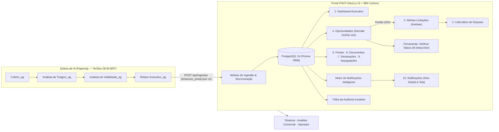
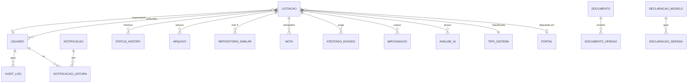
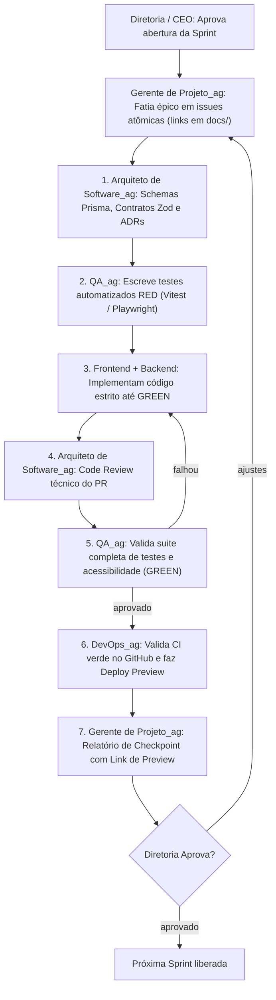

# 🏛️ Plano Diretor Definitivo (v3) — Portal PNCP

> **Nome Provisório:** "Portal PNCP" (configurado centralmente em `src/config/brand.ts` — ver §2.1)  
> **Construção:** 100% autônoma pela Squad de Engenharia no Paperclip via TDD estrito (§11)  
> **Design System:** IBM Carbon Design System (suporte nativo a Tema Claro e Escuro — padrão Claro)  
> **Repositório:** [`alfredo-maia/portal_licitacao`](https://github.com/alfredo-maia/portal_licitacao) · **Workspace VPS:** `/home/hermes/apps/portal_licitacao`  
> **Projeto Paperclip:** `Portal de Licitações` (`83891ed1-1820-4cc8-9b40-2d3fd6840e03`)  
> **Status:** Documento Definitivo Aprovado — Especificação Completa para Execução das Sprints  

---

## 1. Visão Geral e Arquitetura do Ecossistema

O **Portal PNCP** é o sistema web corporativo para visualização, triagem estratégica, deliberação de participação (GO / No-GO), precificação, compliance documental e auditoria de licitações públicas de TI (Software, Nuvem, Infraestrutura e Consultoria).

O portal funciona integrado à **esteira autônoma de inteligência artificial** hospedada no Paperclip, que executa varreduras bi-semanais através da rotina **`Coleta PNCP (terça e sexta)`** (`ac972837-0b35-4c18-9bd7-bb23d6ad7904`) às terças e sextas-feiras às 06:00 BRT no Portal Nacional de Contratações Públicas (PNCP) sob a Lei Federal nº 14.133/2021.



---

## 2. Padrões de Interface & Fundação Técnica

### 2.1. Marca e Nomenclatura Desacoplada (Brand Token)
* **Arquivo Único da Verdade:** `src/config/brand.ts` centraliza:
  ```typescript
  export const APP_CONFIG = {
    brandName: process.env.NEXT_PUBLIC_APP_NAME || "Portal PNCP",
    shortName: "PNCP",
    tagline: "Inteligência e Gestão em Licitações Públicas",
    version: "1.0.0"
  };
  ```
* **Regra Estrita de Qualidade:** É proibido escrever a string literal `"Portal PNCP"` fixa em qualquer arquivo de visualização (páginas, títulos, relatórios, modais, e-mails ou PDFs).
* **Validação de QA (Test Rule):** O pipeline de testes roda varredura automática: qualquer ocorrência de `"Portal PNCP"` fora de `src/config/brand.ts` quebra o build.

### 2.2. Design System: IBM Carbon (Tema Claro & Escuro)
* **Design System Escolhido:** IBM Carbon Design System (`@carbon/react`, `@carbon/charts-react`, `@carbon/icons-react`).
* **Tipografia Corporativa:** Fontes oficiais **IBM Plex Sans** (textos, botões e formulários) e **IBM Plex Mono** (valores em R$, CNPJs, códigos de edital e datas).
* **Temas Suportados:**
  * **Tema Claro (Padrão do Sistema):** Tema `white` / `g10` do Carbon, com máximo contraste para leitura de tabelas densas e longos expedientes operacionais.
  * **Tema Escuro:** Tema `g90` / `g100` do Carbon.
  * **Seletor Global:** Alternador de tema posicionado no topo ao lado do avatar/sino, com persistência no `localStorage` e respeito ao `prefers-color-scheme` do navegador.
* **Componentes Customizados sobre Tokens Carbon:**
  * Kanban com Drag-and-Drop (`@dnd-kit` integrado aos tokens de elevação e cores semânticas do Carbon).
  * Grade mensal de calendário com badges de certames ativos e certidões expirando.
  * Pré-visualização de documentos formato A4 timbrado com paginação.

### 2.3. Autenticação & Usuários Seed (v1)
* **Mecanismo:** Auth.js (NextAuth) com provedor de Credenciais (E-mail + Senha com hash seguro bcrypt) e sessão JWT imutável.
* **Usuários Iniciais Provisionados (Seed no Banco de Dados):**
  1. **Vítor:** `vitorhenrique018@gmail.com` | Senha inicial: `***REDACTED***` | Perfil: `Diretoria`
  2. **Alfredo:** `alfredosouza100@gmail.com` | Senha inicial: `***REDACTED***` | Perfil: `Diretoria`
* **Níveis de Acesso (RBAC):**
  * `Diretoria`: Acesso irrestrito a todas as 11 telas, deliberações GO/No-GO, aprovação de preços, descarte, gestão da equipe e auditoria total.
  * `Analista Comercial`: Gestão operacional das licitações aceitas, upload de editais, montagem de propostas, emissão de declarações e impugnações.
  * `Operador`: Acompanhamento de calendário, consulta de certidões e download de acervos.
* **Camada de Autorização:** Função unificada `can(user, action, resource)` invocada em todas as Server Actions e mutações do sistema.

---

## 3. Navbar Lateral e Mapeamento de Rotas

A interface utiliza o layout **UI Shell** do Carbon, composto por um cabeçalho global fixo (`Header`) e uma barra lateral de navegação colapsável (`SideNav`), organizando as 11 telas do sistema:

| Ordem | Rota | Nome do Módulo | Função Operacional |
| :-: | :--- | :--- | :--- |
| **1** | `/dashboard` | **Dashboard** | Visão executiva mensal, 4 cards de topo, indicadores de resultado e Top 4 histórico. |
| **2** | `/oportunidades` | **Oportunidades** | Tabela densa ordenada por abertura para decisão GO / No-GO e cadastro manual. |
| **3** | `/minhas-licitacoes` | **Minhas Licitações** | Kanban interativo (estilo Trello) com funil de certames aceitos. |
| **4** | `/calendario` | **Calendário** | Grade mensal de certames (chips normais/opacos) e alertas de validade de certidões. |
| **5** | `/portais` | **Portais de Licitações** | Gestão de credenciais (sem senhas), anuidades e alertas de renovação. |
| **6** | `/documentacao` | **Documentação** | Repositório de certidões, balanços, diplomas e atestados (ACT) com alerta vermelho/negrito. |
| **7** | `/declaracoes` | **Declarações** | Gerador dos 8 modelos oficiais (Anexo 5) com preview A4 em tempo real e PDF. |
| **8** | `/impugnacoes` | **Impugnações** | Controle de petições com cálculo automático do prazo de 3 dias úteis (Lei 14.133). |
| **9** | `/robo-de-lances` | **Robô de Lances** | *Placeholder elegante ("Em breve")* desabilitado para a fase atual. |
| **10** | `/notificacoes` | **Notificações** | Central completa de avisos e notificações (Anexo 3), conectada ao sino global. |
| **11** | `/configuracoes` | **Configurações** | Front-only: Perfil, Dados da Empresa, Equipe (Anexo 4) e aba de Logs (conectada ao DB). |

---

## 4. Detalhamento Especificado das 11 Telas

### 4.1. Tela 1 — Dashboard (`/dashboard`)
* **Seletor de Período:** Seletor de Mês e Ano no topo (padrão: mês corrente).
* **Linha 1 — Os 4 Cards Mensais Principais (Clicáveis com Navegação Filtrada):**
  1. 📥 **Recebidas da Coleta PNCP:** Total de editais enviados pela esteira ao portal no mês. *(Clique → `/oportunidades?periodo=mes`)*.
  2. ⏳ **Aguardando Decisão (GO / No-GO):** Quantidade de licitações pendentes de deliberação. Exibe o backlog total pendente com subtítulo indicando as recebidas no mês. *(Clique → `/oportunidades?status=PENDENTE`)*.
  3. 💼 **Em Precificação (GO):** Total de licitações aceitas no mês que estão em elaboração ativa pela equipe. *(Clique → `/minhas-licitacoes`)*.
  4. 🚫 **Recusadas (No-GO):** Total de licitações recusadas no mês. *(Clique → `/oportunidades?status=RECUSADA`)*.
* **Linha 2 — Painel de Desfecho & Resultados das Disputas:**
  * 🏆 **Contempladas (Ganha):** Quantidade e Valor Financeiro total arrematado (R$).
  * ❌ **Não Contempladas (Perdidas):**
    * *Perdidas por Preço* (concorrente deu lance menor).
    * *Perdidas por Documentação/Habilitação* (inabilitação técnica/fiscal).
  * ⚠️ **Desistências:** Licitações abandonadas antes do envio final.
  * ⚖️ **Impugnadas:** Licitações suspensas ou alteradas por contestação jurídica.
  * 📈 **Taxa de Conversão:** $\frac{\text{Contempladas}}{\text{Contempladas} + \text{Perdidas}} \times 100$.
* **Linha 3 — Indicadores Financeiros e Operacionais:**
  * Volume Financeiro Total Estimado em Disputa (R$).
  * Taxa de Viabilidade da Esteira de IA (% de pareceres GO vs. % NO-GO da esteira).
  * Oportunidades Críticas com Abertura nas Próximas 72 Horas (com contagem regressiva).
* **Linha 4 — Inteligência de Mercado & Tendências:**
  * 📊 **Top 4 Tipos de Licitações (Histórico Acumulado):** Ranking dinâmico das categorias com maior volume desde a criação do portal (ex: `1º Portal de Educação (80)` · `2º Saúde / UBS (60)` · `3º Imobiliário (55)` · `4º RH e Folha (50)`). Clique filtra a tabela de Oportunidades pelo tipo correspondente.
  * *(Nota de Requisito: O mini-calendário foi expressamente removido desta tela).*

---

### 4.2. Tela 2 — Calendário de Certames (`/calendario`)
* **Navegação Temporal:** Visão em grade mensal completa (com seletores de mês, ano e botão "Hoje").
* **Regras de Exibição dos Certames:**
  * Uma linha/chip clicável para cada licitação **aceita** (`ACEITA`, `ANALISE_TECNICA`, `ANALISE_FINANCEIRA`, `REVISAO_PROPOSTA`, `ENVIADA`, `EM_DISPUTA`, `AGUARDANDO_RESULTADO`, `CONTEMPLADA`).
  * **Regra de Opacidade:** Licitações cujo status mudou para perda, desistência ou cancelamento (`NAO_CONTEMPLADA_PRECO`, `NAO_CONTEMPLADA_DOCUMENTACAO`, `NAO_CONTEMPLADA_DESISTENCIA`, `REVOGADA_ANULADA`) continuam aparecendo no calendário no dia de abertura original, porém com **estilo opaco (40% de opacidade)**, sinalizando visualmente que o certame ocorreu sem prosseguimento da nossa parte.
  * Licitações recusadas (`RECUSADA`) ou pendentes de decisão (`PENDENTE`) **não poluem o calendário**.
  * **Clique no Chip:** Redireciona diretamente para a tela de detalhes da licitação (`/oportunidades/[id]`).
* **Linhas de Alerta Documental no Calendário:**
  * No dia do vencimento de certidões ou documentos da empresa, o calendário exibe uma faixa de advertência: `⚠️ Certidão Negativa Federal — Vencimento hoje (Atualizar)`. Clique leva para `/documentacao`.

---

### 4.3. Tela 3 — Minhas Licitações / Kanban (`/minhas-licitacoes`)
* **Quadro Interativo Baseado em `@dnd-kit`:**
  * Suporte completo a arrastar cards entre colunas, navegação por teclado e persistência instantânea no banco com gravação no log de auditoria.
* **Colunas Ativas do Pipeline:**
  1. `Aceita (GO)`
  2. `Análise Técnica`
  3. `Análise Financeira`
  4. `Revisão da Proposta`
  5. `Enviada`
  6. `Em Disputa / Lances`
  7. `Aguardando Resultado`
  8. `Contemplada 🏆`
  9. `Impugnada ⚖️` (Coluna de exceção jurídica)
* **Regras de Visibilidade:**
  * Licitações recusadas (`RECUSADA`) **nunca aparecem** neste quadro.
  * Licitações perdidas/desistidas ficam **ocultas por padrão**. Um alternador no topo (*"Exibir arquivadas / perdidas"*) permite visualizá-las em gaveta lateral ou faixa recolhida.
* **Conteúdo do Card:** Órgão e UF · Mini-resumo (2 a 5 palavras) · Valor Estimado (R$) · Data e hora de abertura (tag vermelha se < 72h) · Tag do Tipo de Sistema · Avatares do **Responsável** e dos **Atribuídos**.
* **Modal Obrigatório de Perda:** Mover um card para status de não contemplação ou desistência abre obrigatoriamente um modal rápido para registrar o motivo.

---

### 4.4. Tela 4 — Central de Oportunidades (`/oportunidades`)
* **Tabela de Alta Densidade (Carbon `DataTable`):**
  * Ordenação padrão: **Data de Abertura do Certame** (da mais próxima para a mais distante).
  * **Colunas:** Data de Abertura · Órgão e UF · Mini-resumo (2 a 5 palavras) · Resumo do Objeto (com tooltip) · Valor Estimado (R$, `IBM Plex Mono`) · Parecer da IA (`🟢 GO`, `🟡 AVALIAR`, `🔴 NO-GO`) · Ações Rápidas (botão verde ✔ Aceitar / botão vermelho ✖ Recusar com modal de motivo opcional).
  * **Navegação:** **A linha inteira é clicável**, abrindo a tela de detalhes (`/oportunidades/[id]`).
* **Ações de Topo:**
  * Botão **`+ Adicionar Licitação Manualmente`**: Abre modal para cadastrar certames capturados fora da esteira automática (ex: Diário Oficial ou portais privados).
  * Botão **`Importar Relatório (JSON)`**: Fallback para upload manual do arquivo `licitacoes_portal.json`.
  * Filtros por Tipo de Sistema (22 tipos), UF, Faixa de Valor, Status e Parecer da IA.

---

### 4.4.1. Detalhe da Licitação (`/oportunidades/[id]`)

A tela de dossiê do certame organiza as informações e ferramentas operacionais:

#### A. Cabeçalho Fixo
* Título com Número do Edital e Órgão Contratante.
* Tags de Parecer da IA, Status Atual e Tipo de Sistema.
* Botões de ação rápida: **[ Aceitar (GO) ]** e **[ Recusar (No-GO) ]**.
* Link externo oficial: **"Abrir Edital Oficial no PNCP ↗"**.

#### B. Gestão de Equipe (Responsável & Atribuídos)
* **Responsável (Único):** Campo de seleção para definir o coordenador/líder direto daquela oportunidade.
* **Atribuído(s) (Múltiplos):** Campo multi-seleção de membros da equipe para alocar profissionais de apoio (desenvolvedor técnico, analista financeiro, diretoria).
* *Regra de Notificação:* Qualquer alteração de status ou retificação no PNCP dispara notificações automáticas no sino **tanto para o Responsável quanto para todos os Atribuídos**.

#### C. Aba 1 — Visão Geral & Dados Técnicos
* **Resumo Encorpado:** Texto detalhado do objeto licitado.
* **Estrutura de Lotes:** Quantidade total de lotes · Indicador: **Lote Único** ou **Vários Lotes** · Se vários lotes: indicação se permite **propostas e preços separados por lote** (adjudicação por item/lote) ou exige proposta global.
* **Classificação por Tipo de Sistema:** Campo sugerido pela esteira de IA, **100% editável** pela equipe com os 22 tipos padronizados (§5.1).
* **Logística & Territorialidade:** Modalidade (Eletrônica ou Presencial). Se Presencial: Distância rodoviária em **KM a partir de Goiânia/GO** e estimativa de deslocamento.
* **Datas Oficiais:** Data de Publicação, Data de Abertura da Sessão e **Data da Última Atualização no PNCP**.

#### D. Aba 2 — Arquivos do Edital (Upload Manual)
* Área drag-and-drop para upload dos arquivos oficiais baixados do PNCP (Termo de Referência, Minuta, Anexos, Planilhas).
* **Importante:** O portal **não faz download automático** de arquivos do PNCP na v1; a equipe sobe os arquivos relevantes para manter o acervo centralizado.
* Lista de arquivos com tamanho, data e botão de exclusão individual.

#### E. Aba 3 — Repositórios Similares (Benchmarking de Código)
* *(Habilitada quando a licitação for aceita / GO)*
* Interface para cadastrar **até no máximo 5 links** de repositórios (GitHub, GitLab, open-source) com arquitetura similar ao objeto do edital.
* **Comportamento Visual:** Ao inserir Nome do Repositório + URL e clicar em Adicionar, uma nova linha é criada **acima do campo** exibindo: Nome do Repositório | Botão **"Link"** (que abre a URL em nova aba) | Botão remover.
* Ao atingir 5 links, o input é travado com aviso explicativo.

#### F. Aba 4 — 🤖 Ferramenta IA: "Verificar Status de Participação" (Deep Dive)
Botão em destaque **`[ 🤖 Verificar Status de Participação ]`** abre modal de inteligência artificial profunda:
1. **Seleção de Documentos de Contexto:**
   * Lista os arquivos anexados à oportunidade com caixas de seleção e **ícone de "X"** para remover da análise arquivos pesados ou dispensáveis (plantas, obras, editais duplicados).
   * Lista os documentos da empresa cadastrados no portal (Balanço, Certidões, ACTs, Diplomas).
   * **Otimização de Contexto:** Em vez de enviar PDFs pesados de centenas de páginas, o sistema extrai e envia para a LLM apenas **metadados e dados estruturados em JSON** (validade, objeto do atestado, quantitativos técnicos, índices de liquidez do balanço).
2. **Pergunta de Verificação de Ausências:**
   * A interface pergunta: *"Há mais algum documento relevante a ser considerado?"*. Se o usuário indicar que sim, recomenda fazer o upload antes do processamento.
3. **Campos Opcionais de Refinamento:**
   * Input: *Temos algum sistema base proprietário similar?* (campo de texto livre).
   * Input: *Repositório Open-Source de referência:* (URL/descrição).
   * Input: *Observações estratégicas adicionais:* (campo livre).
4. **Inspeção Prévia do Script/Prompt:**
   * O sistema exibe o **Script estruturado completo** gerado e disponibiliza o botão **`[ 📋 Copiar Script ]`**, permitindo ao usuário rodar diretamente no ChatGPT, Gemini ou Claude caso prefira ou ocorra instabilidade de rede.
5. **Relatório Gerado pela IA:**
   * **Impedimentos Documentais:** Análise cruzada da documentação exigida vs. documentos da empresa, apontando ausência de certidão, atestado insuficiente ou índice contábil impeditivo.
   * **Viabilidade Técnica e Estimativa de Prazos:** Prazo estimado partindo do zero vs. adaptando sistema base vs. customizando open-source versus prazo de entrega do edital.
   * **Composição de Custos:** Nuvem/servidores · APIs de IA · Carga tributária · Logística/hospedagem (se presencial).
   * **Sugestão de Preço de Lance:** Valor mínimo e valor-alvo mantendo margem de lucro saudável.
6. **Ação de Persistência:** Botão **`[ 💾 Salvar Relatório na Licitação ]`** grava a análise no banco e anexa ao histórico do certame.

---

### 4.5. Tela 5 — Portais de Licitações (`/portais`)
* **Catálogo de Portais:** Gestão de plataformas de disputa (Compras.gov.br, Compras Públicas, Licitações-e, BLL Compras, BBMNet, etc.).
* **Botão `+ Novo Portal`:** Cadastro de plataforma.
* **Status do Portal:** `Não cadastrado` · `Pré-cadastro` · `Aguardando aprovação` · `Cadastrado` · `Rejeitado` · `Vencido` · `Suspenso`.
* **Detalhes do Portal (`/portais/[id]`):** Nome e Link oficial · **Credenciais (Segurança):** Armazena apenas **Login / E-mail / CNPJ / Usuário**. **NÃO armazena senhas** no banco de dados · Valor da Assinatura (R$) e Periodicidade · Data de Vencimento da Assinatura · Flag: Aceita Robô de Lances? · Exige Certificado Digital (A1/A3)? · Contatos de Suporte técnico · Histórico de certames disputados.
* **Notificações Automáticas de Renovação (5 Avisos):** Dispara notificações com antecedência exata de: **1 mês, 3 semanas (21 dias), 2 semanas (14 dias), 1 semana (7 dias) e 1 dia antes do vencimento da assinatura**.

---

### 4.6. Tela 6 — Documentação de Habilitação (`/documentacao`)
* **Repositório Central de Habilitação:** Documentação da empresa necessária para certames públicos.
* **Botão `+ Novo Documento`:** Upload com metadados (Nome, Tipo, Categoria).
* **Controle de Validade:** Data de Vencimento + Checkbox **"Sem validade"** (documentos permanentes: diplomas, contratos sociais e atestados definitivos).
* **Alerta Visual Estrito:** Documento vencido ou vencendo em ≤ 30 dias é exibido **obrigatoriamente em cor vermelha e estilo negrito** (`support-error` Carbon).
* **Notificações de Vencimento (3 Avisos):** Alertas com antecedência de: **1 mês (30 dias), 2 semanas (14 dias) e 1 dia antes da expiração**.
* **Versionamento:** Atualizar um documento arquiva a versão anterior e coloca o novo no topo, mantendo rastreabilidade.

---

### 4.7. Tela 7 — Declarações Oficiais (`/declaracoes`)
Interface baseada nos **Anexos 1, 2 e 5**: divisão em duas colunas (coluna esquerda com formulário dinâmico, coluna direita com **Modelo Impresso / Pré-visualização A4** em tempo real e botão de exportação).

* **Os 8 Modelos Oficiais Iniciais (Conforme Anexo 5):**
  1. 📄 **Carta de Credenciamento** (Representante/procurador legal para a sessão pública).
  2. 📄 **Declaração de Elaboração Independente de Proposta** (Art. 9º, III da Lei nº 14.133/2021).
  3. 📄 **Declaração de Inexistência de Fatos Impeditivos** (Idoneidade e ausência de sanções legais).
  4. 📄 **Declaração de Não Trabalho Forçado e Degradante** (Conformidade trabalhista e direitos humanos).
  5. 📄 **Declaração de Renúncia de Vistoria** (Conhecimento pleno do local sem vistoria técnica presencial).
  6. 📄 **Declaração de Habilitação** (Pleno atendimento aos requisitos editalícios de habilitação jurídica, fiscal e técnica).
  7. 📄 **Declaração de Micro Empresa ou Empresa de Pequeno Porte (ME/EPP)** (Benefícios da LC 123/2006).
  8. 📄 **Declaração que não emprega menor de idade, salvo na condição de aprendiz** (Art. 7º, XXXIII da CF/88).
* **Pré-preenchimento Inteligente:** Dados da Empresa (Razão Social, CNPJ, Representante Legal, RG, CPF) puxados das Configurações; Órgão e Edital vinculáveis a certame cadastrado.
* **Exportação:** Geração de documento PDF formatado para impressão A4, pronto para assinatura digital Gov.br / ICP-Brasil.

---

### 4.8. Tela 8 — Robô de Lances (`/robo-de-lances`)
* **Status:** Módulo planejado para evolução futura.
* **Entrega Inicial:** Página informativa com mensagem "Módulo em Construção / Em Breve", mantendo a coerência visual do menu lateral.

---

### 4.9. Tela 9 — Impugnações e Esclarecimentos (`/impugnacoes`)
* **Objetivo:** Gestão jurídica contra cláusulas restritivas ou ilegais em editais de TI.
* **Cálculo de Prazo Fatal Automático:** Alerta com base no Art. 164 da Lei 14.133/2021: **até 3 dias úteis antes da data de abertura da sessão pública**.
* **Funil de Controle:** `Rascunho de Minuta` $\rightarrow$ `Protocolada` $\rightarrow$ `Acatada (Edital Retificado)` $\rightarrow$ `Indeferida`.
* **Gerador de Minutas:** Template com referências a súmulas do TCU contra direcionamento de edital.

---

### 4.10. Tela 10 — Notificações (`/notificacoes`)
* **Padrão do Anexo 3:** Lista de cartões com ponto azul para não lidas, título, descrição clara, data/hora e ação individual "Marcar como lida". Botão em lote no topo: **`[ ✔ Marcar todas como lidas ]`**.
* **Sino Global (Header):** Presente no topo de todas as páginas com badge de contagem e dropdown dos 5 avisos mais recentes.

---

### 4.11. Tela 11 — Configurações (`/configuracoes`) — **Front-end Only (v1)**
Construída no front-end sobre uma camada de serviço abstrata (`SettingsService`) com `localStorage` / mocks:
1. **Aba Perfil:** CRUD de Nome Completo, CPF (máscara e validação), E-mail, WhatsApp e Endereço Residencial.
2. **Aba Dados da Empresa:** Razão Social, Nome Fantasia, CNPJ, Inscrições Estadual/Municipal, Representante Legal, Cargo, CPF/RG do Representante e Endereço da Sede.
3. **Aba Gestão da Equipe (Anexo 4):** Tabela de membros com avatar, nome, e-mail, nível de acesso (`Diretoria`, `Analista Comercial`, `Operador`), status (`Ativo / Inativo`) e botão **`+ Novo Membro`** com modal.
4. **Aba Logs de Atividade:** Conexão real com a tabela `audit_log` do banco de dados (ver §7).

---

## 5. Taxonomia: Status e Tipos de Sistema

### 5.1. Os 22 Tipos de Sistema Padronizados
O campo `tipoSistema` é sugerido na triagem da IA e refinado no portal:

| # | Código | Nome do Tipo de Sistema |
| :-: | :--- | :--- |
| 1 | `SISTEMA_NOVO` | Sistema Novo (Desenvolvimento Sob Medida / Fábrica de Software) |
| 2 | `GESTAO_PUBLICA_ERP` | Gestão Pública (ERP Municipal / Administrativo Completo) |
| 3 | `EDUCACAO_PORTAL` | Portal de Educação (Gestão Escolar, Matrícula, Diário, Merenda) |
| 4 | `SAUDE_ATENCAO_BASICA` | Saúde (Atenção Básica, UBS, Prontuário Eletrônico, Regulação) |
| 5 | `HOSPITALAR` | Hospitalar (Gestão Hospitalar, UTI, Emergência, Leitos) |
| 6 | `CONTABIL_ORCAMENTARIO` | Contábil / Financeiro / Orçamentário / Tesouraria |
| 7 | `ASSISTENCIA_SOCIAL` | Assistência Social (CRAS, CREAS, Cadastro de Benefícios) |
| 8 | `GOVERNANCA_CORPORATIVA` | Governança Corporativa / Auditoria / Gestão Estratégica |
| 9 | `RH_FOLHA` | RH / Gestão de Pessoas / Folha de Pagamento |
| 10 | `BANCARIO_FINANCEIRO` | Bancário / Operações Financeiras / Conciliação Bancária |
| 11 | `TRIBUTARIO_ARRECADACAO` | Tributário / Arrecadação (IPTU, ISS, Nota Fiscal Eletrônica NFS-e) |
| 12 | `PROTOCOLO_PROCESSO_ELETRONICO` | Protocolo, Gestão Documental e Processo Administrativo Eletrônico |
| 13 | `PATRIMONIO_ALMOXARIFADO_FROTA` | Almoxarifado, Controle Patrimonial e Gestão de Frotas |
| 14 | `TRANSPARENCIA_OUVIDORIA` | Portal da Transparência / Ouvidoria / e-SIC |
| 15 | `PREVIDENCIA_RPPS` | Previdência e Gestão de Regime Próprio (RPPS) |
| 16 | `SANEAMENTO_AGUA_ESGOTO` | Saneamento Básico, Comercial e Faturamento de Água e Esgoto |
| 17 | `URBANISMO_LICENCIAMENTO` | Urbanismo, Obras, Alvará e Licenciamento Eletrônico |
| 18 | `BI_ANALYTICS_DADOS` | Business Intelligence (BI), Ciência de Dados e Dashboards |
| 19 | `INFRA_CLOUD_SUPORTE` | Infraestrutura de TI, Nuvem, Datacenter, NOC e Suporte Técnico |
| 20 | `LICENCA_SOFTWARE` | Compra e Renovação de Licenças de Software |
| 21 | `IMOBILIARIO` | Imobiliário (Gestão e Regularização de Bens e Terras Públicas) |
| 22 | `OUTROS` | Outros (Campo livre para novas especialidades de software) |

---

## 6. Motor de Notificações Inteligente (Anti-Spam & Resiliente)

### 6.1. Arquitetura de Verificação de Atualizações (N2)
* **Sem Polling Infinito:** O portal não realiza consultas periódicas descontroladas ao PNCP para cada licitação cadastrada.
* **Mecanismo de Delta Global:** O coletor consulta o endpoint oficial de atualização do PNCP:
  `GET https://pncp.gov.br/api/consulta/v1/contratacoes/atualizacao?dataInicial=YYYYMMDD&dataFinal=YYYYMMDD`
  com paginação controlada, verificando apenas registros alterados (`dataAtualizacaoGlobal`).
* **Detecção Cirúrgica de Mudanças:** O portal calcula o hash SHA-256 dos campos críticos (`dataAberturaProposta`, `valorTotalEstimado`, `situacaoCompraId`, `informacaoComplementar`). Se e somente se o hash for diferente:
  1. O registro da licitação é atualizado no banco.
  2. **Se a data de abertura for modificada pelo órgão, a data é atualizada instantaneamente no banco e reflete de imediato no Calendário**.
  3. Uma notificação N2 é emitida aos envolvidos.

### 6.2. Matriz de Eventos de Notificação

| ID | Evento | Gatilho / Origem | Destinatários | Frequência / Regra |
| :-: | :--- | :--- | :--- | :--- |
| **N1** | Relatório de Coleta Concluído | Ingestão ter/sex finalizada | Toda a equipe | Imediato após processamento. |
| **N2** | Licitação Atualizada no PNCP | Alteração em campo crítico | **Responsável + Atribuídos** | Imediato após reingestão. |
| **N3** | Licitação com Abertura Amanhã | Licitação ativa em D+1 | **Responsável + Atribuídos** | D−1 dia às 07:00 BRT. |
| **N4** | Licitação Presencial se Aproximando | Licitação ativa presencial | **Responsável + Atribuídos** | **D−7 dias** (1 semana antes) e D−1 dia. |
| **N5** | Licitação Pendente Crítica | `status = PENDENTE` e abertura < 72h | Diretoria / Comercial | Diário até haver decisão (GO ou No-GO). |
| **N6** | Vencimento de Assinatura de Portal | `portal.dataVencimento` | Diretoria / Comercial | **5 vezes:** 1 mês, 3 semanas, 2 semanas, 1 semana e 1 dia antes. |
| **N7** | Vencimento de Documento/Certidão | `documento.validade` | Toda a equipe | **3 vezes:** 1 mês, 2 semanas e 1 dia antes. |
| **N8** | Prazo Limite de Impugnação | 3 dias úteis antes da abertura | Diretoria / Jurídico | 2 dias e 1 dia útil antes do prazo final. |

---

## 7. Trilha de Auditoria (Audit Log)

* **Princípio Imutável:** Todas as mutações passam por middleware/extensão Prisma no backend gravando na tabela `audit_log`:
  ```
  id · ocorridoEm · usuarioId · usuarioNome · ip · acao · entidadeTipo · entidadeId · antes(JSON) · depois(JSON)
  ```
* **Eventos Rastreados:** Decisões GO/No-GO, movimentações no Kanban, alteração de Responsável e Atribuídos, uploads/exclusões de arquivos, links de benchmark, certidões, portais, relatórios da ferramenta de IA e geração de declarações.
* **Exibição:** Aba Histórico individual no detalhe da licitação e Aba Logs de Atividade em Configurações (com busca, filtros e exportação CSV para a Diretoria).

---

## 8. Contrato de Ingestão de Dados v2 (`licitacoes_portal.json`)

Arquivo gerado pela esteira do Paperclip através da rotina `Coleta PNCP (terça e sexta)` (`ac972837-0b35-4c18-9bd7-bb23d6ad7904`) para o endpoint `POST /api/ingestao`:

```json
{
  "versaoContrato": 2,
  "executadoEm": "2026-10-24T09:00:00Z",
  "totalRegistros": 1,
  "licitacoes": [
    {
      "pncpId": "00394452000103-1-000042/2026",
      "numeroEdital": "PE 42/2026",
      "orgao": {
        "cnpj": "00394452000103",
        "nome": "Prefeitura Municipal de Exemplo",
        "esfera": "MUNICIPAL",
        "poder": "EXECUTIVO",
        "uf": "GO",
        "municipio": "Anápolis"
      },
      "modalidade": "Pregão Eletrônico",
      "portalDisputa": "Compras.gov.br",
      "valorEstimado": 1450000.00,
      "dataPublicacaoPncp": "2026-10-23T10:00:00Z",
      "dataAbertura": "2026-11-05T09:00:00Z",
      "dataUltimaAtualizacao": "2026-10-24T08:15:00Z",
      "isPresencial": false,
      "distanciaGoianiaKm": 55,
      "miniResumo": "Portal de Educação",
      "resumo": "Contratação de empresa especializada para fornecimento de solução integrada de gestão escolar, portal do aluno e diário eletrônico em nuvem.",
      "tipoSistemaSugerido": "EDUCACAO_PORTAL",
      "quantidadeLotes": 1,
      "loteUnico": true,
      "precoPorLote": false,
      "parecerGoNoGo": "GO",
      "justificativaTecnica": "Objeto 100% aderente ao core de software. Prazos e atestados em conformidade com o Art. 67 da Lei 14.133/2021.",
      "atestadosExigidos": [
        "Atestado comprovando desenvolvimento ou implantação de software de gestão escolar para no mínimo 10.000 alunos."
      ],
      "linkPncp": "https://pncp.gov.br/app/editais/00394452000103/2026/42",
      "linkSistemaOrigem": "https://www.comprasnet.gov.br"
    }
  ]
}
```

---

## 9. Modelo de Dados Relacional (Prisma Schema)



### 9.1. Principais Entidades e Campos:
* **`Licitacao`**: `id`, `idPncp` (UK), `numeroEdital`, `orgaoNome`, `orgaoCnpj`, `uf`, `municipio`, `modalidade`, `miniResumo`, `resumo` (Text), `valorEstimado`, `dataAbertura`, `dataUltimaAtualizacao`, `quantidadeLotes`, `loteUnico`, `precoPorLote`, `isPresencial`, `distanciaGoianiaKm`, `parecerIA`, `justificativaIA`, `status`, `tipoSistemaId`, `portalId`, `linkPncp`, `linkSistemaOrigem`, `responsavelId` (FK User), `hashCritico` (SHA-256).
* **`LicitacaoAtribuido`**: Relação many-to-many entre `Licitacao` e `Usuario` (múltiplos atribuídos).
* **`RepositorioSimilar`**: `id`, `licitacaoId` (FK), `nome`, `url`, `criadoEm` (constraint de no máximo 5 por licitação).
* **`AnaliseStatusParticipacao`**: `id`, `licitacaoId` (FK), `scriptUtilizado` (Text), `relatorioGerado` (Text), `impedimentos` (JSON), `viabilidadePrazos` (JSON), `custosEstimados` (JSON), `precoSugerido` (JSON), `executadoPorId` (FK User), `criadoEm`.
* **`Portal`**: `id`, `nome`, `linkOficial`, `status`, `loginUsuario`, `valorAssinatura`, `periodicidade`, `dataVencimento`, `aceitaRobo`, `exigeCertificado`, `suporteTelefone`, `suporteEmail`, `observacoes`. *(Sem senhas em banco)*.
* **`Documento`**: `id`, `nome`, `tipo`, `categoria`, `validade`, `semValidade` (Boolean), `arquivoAtualId`.
* **`DeclaracaoGerada`**: `id`, `modeloTipo`, `licitacaoId`, `dadosPreenchidos` (JSON), `caminhoPdf`, `geradoPorId`.
* **`Impugnacao`**: `id`, `licitacaoId`, `status` (`RASCUNHO`, `PROTOCOLADA`, `ACATADA`, `INDEFERIDA`), `dataLimite`, `textoMinuta` (Text), `protocoloNumero`.
* **`Notificacao`**: `id`, `tipo` (N1 a N8), `titulo`, `descricao`, `severidade`, `linkDestino`, `chaveIdempotencia` (UK), `criadaEm`.
* **`AuditLog`**: `id`, `ocorridoEm`, `usuarioId`, `usuarioNome`, `ip`, `acao`, `entidadeTipo`, `entidadeId`, `antes` (JSON), `depois` (JSON).

---

## 10. Requisitos Não Funcionais & Segurança

* **Idioma e Formatação:** pt-BR nativo; datas `DD/MM/AAAA`; valores monetários em Real (R$); timezone oficial `America/Sao_Paulo` (UTC no banco).
* **Acessibilidade:** Conformidade WCAG 2.1 AA através do IBM Carbon Design System, suporte a teclado no Kanban e alto contraste.
* **Performance:** Consultas paginadas no servidor com tempos de resposta < 300 ms (índices em `dataAbertura`, `status`, `tipoSistemaId`, `idPncp`).
* **Segurança de Credenciais:** Segredos e chaves de API mantidos exclusivamente em variáveis de ambiente. As credenciais de portais em `/portais` guardam apenas login/usuário, **nunca senhas**.
* **Integridade de Arquivos:** Upload com validação de MIME type, sanitização de nomes de arquivo e limite máximo por anexo.

---

## 11. Governança da Squad no Paperclip & Regras de Ouro

### 11.1. Mapeamento da Squad Completa no Paperclip

| Papel | Nome do Agente no Paperclip | ID do Agente | Responsabilidade |
| :--- | :--- | :--- | :--- |
| **Diretoria / Estratégia** | `CEO_ag` / `Você` | `fb74c3c0-1788-4a50-b4eb-a52183921a8c` | Validação de escopo, aprovação dos checkpoints de cada Sprint e destravamento de marcos. |
| **Gerente de Projeto** *(Orquestrador Ágil)* | `Gerente de Projeto_ag` | `e4709d94-3d4d-43c4-8f62-98629e785c12` | Fatiamento de épicos em issues no Paperclip com links em `docs/`, orquestração do ciclo TDD estrito, controle de DoR/DoD e relatórios de entrega por Sprint. |
| **Arquiteto de Software** *(Tech Lead)* | `Arquiteto de Software_ag` | `6ee7b192-bdd3-473b-b1e6-cf80fbd5ab9a` | Schemas Prisma, contratos Zod, revisão técnica de PRs, autorização `can()`, integridade de auditoria e liderança técnica. |
| **Desenvolvedor Frontend** | `Desenvolvedor Frontend_ag` | `21130286-4f7f-4bee-959b-1e606787a2a3` | Componentes Carbon, UI Shell, Kanban (`@dnd-kit`), Calendário, Declarações e telas front-only. |
| **Desenvolvedor Backend** | `Desenvolvedor Backend_ag` | `ae82a9b4-e510-4dce-b63d-5600b3e40fb7` | Ingestão v2, jobs de notificação, uploads, Prisma Server Actions, gerador de PDF e auditoria. |
| **QA / Tester** | `QA_ag` | `545f6e57-8c2d-49ce-8dd7-32eba8795c0b` | **TDD Estrito:** escreve testes RED antes da implementação e valida o estado GREEN. |
| **DevOps** | `DevOps_ag` | `68ab23bf-fb6c-410a-8a76-7f0a54a17f54` | Docker Compose, Postgres VPS, Caddy Proxy, GitHub Actions CI/CD e monitoramento. |

### 11.1.1. Matriz de Skills Atribuídas à Squad (Padrões skills.sh)

| Agente | Skills Vinculadas no Paperclip | Objetivo Operacional |
| :--- | :--- | :--- |
| **`Gerente de Projeto_ag`** | `agile-sprint-orchestration`<br>`paperclip-converting-plans-to-tasks`<br>`definition-of-done-governance`<br>`paperclip-board`<br>`git-workflow-conventional-commits`<br>`paperclip` | Orquestração do ciclo TDD, conversão de planos em issues com dependências, controle de DoD/DoR e checkpoints com a Diretoria. |
| **`Arquiteto de Software_ag`** | `improve-codebase-architecture`<br>`schema-first-contracts`<br>`definition-of-done-governance`<br>`paperclip-converting-plans-to-tasks`<br>`paperclip` | Modelagem profunda de domínios, design de schemas Zod/Prisma, ADRs e code review de PRs. |
| **`Desenvolvedor Frontend_ag`** | `carbon-design-system-react`<br>`nextjs-app-router-best-practices`<br>`frontend-tdd-green-workflow`<br>`paperclip` | Implementação de componentes Carbon, acessibilidade WCAG 2.1 AA e resolução de testes visuais (Fase GREEN). |
| **`Desenvolvedor Backend_ag`** | `backend-tdd-green-workflow`<br>`nodejs-api-best-practices`<br>`postgres-prisma-patterns`<br>`paperclip` | Implementação de APIs resilientes, queries Prisma otimizadas, ingestão v2 e audit log (Fase GREEN). |
| **`QA_ag`** | `qa-tdd-red-workflow`<br>`playwright-e2e-best-practices`<br>`vitest-unit-and-contracts`<br>`paperclip` | Criação antecipada de testes RED (Playwright/Vitest), validação final GREEN e blindagem contra regressão. |
| **`DevOps_ag`** | `docker-nextjs-production`<br>`ci-cd-github-actions-automation`<br>`git-workflow-conventional-commits`<br>`paperclip` | Containers Docker na VPS, pipeline GitHub Actions com SSH na porta 2000 e deploys de preview. |

---

### 11.2. Ciclo de Trabalho por Sprint & Orquestração TDD



### 11.3. O Ciclo em 7 Etapas Rigorosas
1. **Etapa 1 — Fatiamento & Backlog (Gerente de Projeto):** O `Gerente de Projeto_ag` recebe a Sprint aprovada pela Diretoria e fatia as issues referenciando os caminhos de arquivos em `docs/` no repositório (regra anti-`E2BIG`).
2. **Etapa 2 — Arquitetura, Schemas & Contratos (Arquiteto de Software):** O `Arquiteto de Software_ag` cria os schemas Prisma (`prisma/schema.prisma`), migrations versionadas, contratos Zod (`src/server/schemas/`) e interfaces TypeScript necessárias.
3. **Etapa 3 — Especificação de Testes RED (QA):** Com os contratos e tipos definidos pelo Arquiteto, o `QA_ag` escreve os testes automatizados (Vitest e Playwright). Os testes falham intencionalmente (RED).
4. **Etapa 4 — Implementação GREEN (Desenvolvedor Frontend & Backend):** O `Desenvolvedor Frontend_ag` e o `Desenvolvedor Backend_ag` escrevem o código estritamente necessário para fazer os testes do QA passarem (GREEN).
5. **Etapa 5 — Revisão Técnica (Arquiteto de Software):** O `Arquiteto de Software_ag` realiza a revisão de código (Code Review) do PR, garantindo conformidade com o Carbon Design System, camadas de serviço limpas, autorização `can()` e registro de auditoria.
6. **Etapa 6 — Validação Final & Regressão (QA):** O `QA_ag` roda a suíte completa de testes, valida ausência de regressões, acessibilidade WCAG e ausência de hardcode da marca fora de `src/config/brand.ts`.
7. **Etapa 7 — Deploy de Preview & Checkpoint (DevOps & Gerente de Projeto):** O `DevOps_ag` valida o CI/CD no GitHub Actions e atualiza o preview na VPS. O `Gerente de Projeto_ag` consolida o relatório e notifica a **Diretoria (`Vítor / Alfredo / CEO_ag`)** para validação e destravamento da próxima sprint.

---

## 12. Roadmap de Execução em 7 Sprints

```mermaid
gantt
    title Cronograma de Entrega das Sprints — Portal PNCP
    dateFormat  YYYY-MM-DD
    section Fundação
    Sprint 0: Golden Template, Carbon Shell & TDD      :active, S0, 2026-10-26, 3d
    section Negócio & Decisão
    Sprint 1: Ingestão v2 & Oportunidades (GO/No-GO)   :S1, after S0, 4d
    Sprint 2: Detalhes, Análise IA & Minhas Licitações :S2, after S1, 4d
    Sprint 3: Dashboard, Calendário & Notificações     :S3, after S2, 4d
    section Gestão & Compliance
    Sprint 4: Portais & Documentação de Habilitação    :S4, after S3, 3d
    Sprint 5: 8 Declarações (Anexo 5) & Impugnações    :S5, after S4, 4d
    section Finalização
    Sprint 6: Configurações, Logs, Hardening & Deploy  :S6, after S5, 3d
```

### Detalhamento das Entregas por Sprint:

* **Sprint 0: Golden Template, UI Shell & Infraestrutura Base**
  * Setup Next.js 15 App Router com TypeScript estrito.
  * Provedor de Tema Carbon com alternador Claro (`white`) / Escuro (`g100`).
  * Layout Shell global (`Header` com avatar, sino e tema + `SideNav` com as 11 rotas mapeadas).
  * Setup Vitest, Playwright, Prisma ORM e Auth.js com os dois usuários seed da Diretoria.
  * *Entregável:* Esqueleto navegável online, login funcionando e pipeline CI/CD validado.

* **Sprint 1: Ingestão de Dados v2 & Central de Oportunidades**
  * Endpoint `POST /api/ingestao` validado com o contrato JSON v2 e importador manual.
  * Tabela Carbon de Oportunidades com ordenação por abertura, filtros e ações Aceitar/Recusar.
  * Modal para adicionar licitação manualmente e seed dos 22 tipos de sistema.
  * *Entregável:* Importação de lote real e deliberação operacional GO / No-GO.

* **Sprint 2: Detalhes do Certame, Análise IA & Minhas Licitações (Kanban)**
  * Tela de detalhes completa: gestão de lotes, repositórios de benchmarking (máx 5) e upload manual de editais.
  * Atribuição de Responsável único e múltiplos Atribuídos (com notificações para ambos).
  * **Modal "Verificar Status de Participação" (IA Deep Dive com geração e cópia de Script)**.
  * Quadro Kanban interativo (`@dnd-kit`) com colunas ativas e modal de justificativa de perdas.
  * *Entregável:* Gestão completa do fluxo de uma oportunidade aceita.

* **Sprint 3: Dashboard Executivo, Calendário & Notificações**
  * Dashboard: 4 cards mensais superiores, métricas de resultado, taxas de conversão e Top 4 histórico.
  * Calendário mensal com chips normais/opacos e alertas de vencimento de certidões.
  * Motor de notificações N1 a N8, sino global com badge e tela de Notificações (Anexo 3).
  * *Entregável:* Visão executiva em tempo real e sistema de alertas anti-spam ativo.

* **Sprint 4: Portais de Licitações & Documentação de Habilitação**
  * Catálogo de portais (credenciais sem senhas, alertas de anuidade 30, 21, 14, 7 e 1 dia).
  * Repositório de documentos de habilitação (alertas 30, 14 e 1 dia com estilo vermelho/negrito).
  * *Entregável:* Acervo corporativo seguro e compliance documental centralizado.

* **Sprint 5: Os 8 Modelos de Declaração (Anexo 5) & Impugnações**
  * Gerador das 8 declarações oficiais com pré-visualização A4 em tempo real e exportação em PDF.
  * Módulo de impugnações com cálculo automático do prazo de 3 dias úteis e minutas jurídicas.
  * *Entregável:* Ferramenta de geração de peças jurídicas e documentais pronta para uso.

* **Sprint 6: Configurações, Trilha de Auditoria & Produção**
  * Telas de Configurações front-only (Perfil, Dados da Empresa, Gestão de Equipe do Anexo 4).
  * Painel de Logs de Auditoria com filtros, busca e exportação CSV.
  * Testes de regressão E2E, validação de acessibilidade WCAG, deploy em produção e entrega da v1.0.

---

## 13. Fora do Escopo Inicial & Evoluções Futuras (v2)

* Robô de lances automático com conexão via sockets de portais (placeholder informativo na v1).
* Download automático em background de anexos volumosos diretamente do PNCP (upload manual na v1).
* Notificações push via WhatsApp/Telegram (integração futura com Hermes).
* Automação de lances e precificação algorítmica em pregões ao vivo.
* Gestão financeira e contratual pós-arrematação (medições, notas fiscais e aditivos contratuais).
